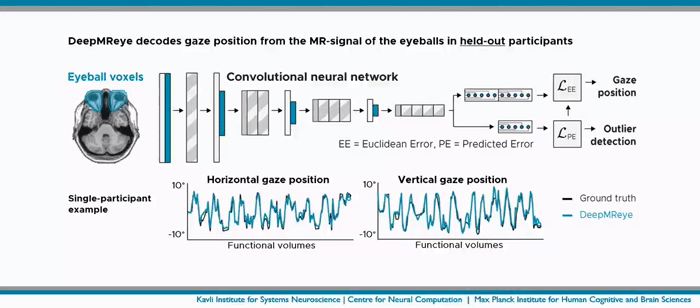
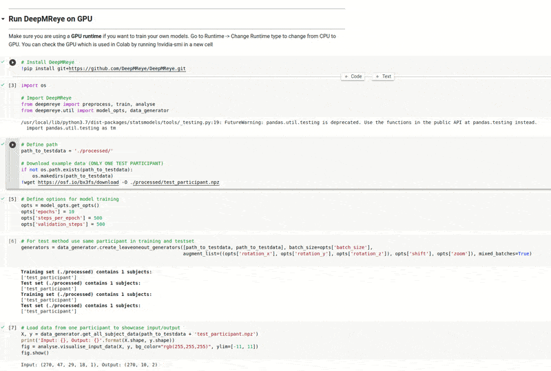

[](http://www.gnu.org/licenses/gpl-3.0)


[](https://doi.org/10.1038/s41593-021-00947-w)


# DeepMReye: magnetic resonance-based eye tracking using deep neural networks
This [Jupyter Notebook](./notebooks/deepmreye_example_usage.ipynb) provides a step-by-step walkthrough of the code. It includes eyeball coregistration, voxel extraction, model training and test as well as basic performance measures. Alternatively, here is a [Colab Notebook](https://colab.research.google.com/drive/1kYVyierbKdNZ3RY4_pbACtdWEw7PKQuz?usp=sharing) that runs in the browser. DeepMReye also includes a user-friendly streamlit app (installation option 4): Drag and drop your fMRI data into the interface and download your gaze coordinates shortly after.

This [Data Repository](https://osf.io/mrhk9/) includes exemplary data for model training and test, source data of all paper figures as well as pre-trained model weights.

If you have questions, please check out our [Frequently Asked Questions](https://github.com/DeepMReye/DeepMReye/wiki/DeepMReye-%E2%80%90-FAQ) page. If you cannot find the answer to your question there, reach out to us!



## Installation

### Option 1: Pip install

#### Pip installation
Install DeepMReye with a CPU/GPU version of [TensorFlow](https://www.tensorflow.org/install/) using the following command.
```
pip install deepmreye
```

#### Anaconda / Miniconda installation

To encapsulate DeepMReye in a virtual environment install with the following commands:
```
conda create --name deepmreye python=3.11
conda activate deepmreye
pip install deepmreye
```
For GPU support (Linux only), follow the tensorflow [install](https://www.tensorflow.org/install/pip) instructions, e.g.:
```
pip install "tensorflow[and-cuda]"
```

To run the example notebooks, install the extra dependencies they need:
```
pip install "deepmreye[notebooks]"
```
If installation of [ANTsPy](https://github.com/ANTsX/ANTsPy) fails try to manually install it via:
```
git clone https://github.com/ANTsX/ANTsPy
cd ANTsPy
pip install CMake
python3 setup.py install
```

### Option 2: Colab

We provide a [Colab Notebook](https://colab.research.google.com/drive/1kYVyierbKdNZ3RY4_pbACtdWEw7PKQuz?usp=sharing) showcasing model training and evaluation on a GPU provided by Google Colab. To use your own data, preprocess your data locally and upload only the extracted eyeball voxels. This saves space and avoids data privacy issues. See the [Jupyter Notebook](./notebooks/deepmreye_example_usage.ipynb) for the preprocessing and eyeball-extraction code.

[](https://colab.research.google.com/drive/1kYVyierbKdNZ3RY4_pbACtdWEw7PKQuz?usp=sharing)



### Option 3: Docker

Pull the image from docker hub.

```bash
docker pull deepmreye/deepmreye
```

Use deepMReye in a docker container via jupyterlab:

```bash
mkdir -p $PWD/notebooks
docker run -it --rm \
    --publish 8888:8888 \
    --volume $PWD/notebooks:/home/neuro/notebooks \
    deepmreye/deepmreye:latest \
        jupyter-lab --no-browser --ip 0.0.0.0
```

### Option 4: Streamlit app

If you would like decode gaze coordinates in your data using a pretrained model, the easiest way is using our streamlit app.

Running the following commands will open a browser window that allows you to upload your data (.nii or .nii.gz) and then download the corresponding gaze coordinates shortly after.
Please read our [FAQ page](https://github.com/DeepMReye/DeepMReye/wiki/DeepMReye-%E2%80%90-FAQ) before using the pretrained models.

```bash
git clone https://github.com/DeepMReye/DeepMReye.git
cd DeepMReye
pip install ".[streamlit]"
streamlit run streamlit/streamlit.py
```

### Data formats
The <u>**fMRI data**</u> should be organized in 4D NIFTI files (.nii), containing the realigned 3D images acquired over time. The pipeline then extracts the eyeball voxels automatically and saves them as Python Pickle files, which serve as model input. For model training, you additionally need <u>**training labels**</u>, a numpy array containing 10 gaze coordinates per functional volume. These gaze coordinates can either be camera-based eye-tracking labels or the coordinates of a fixation target, and many file formats can be easily read (e.g. .npy, .npz, .mat, .csv etc.).

## Hardware requirements

The GPU version of DeepMReye requires a NVIDIA GPU.

## Software requirements
DeepMReye requires Python 3.11 or later. The following python dependencies are automatically installed when installing DeepMReye (see [pyproject.toml](./pyproject.toml); minimum versions in parentheses):
```
tensorflow (2.16.1)
keras (3.0.0)
antspyx (0.6.1)
numpy (1.23.5)
pandas (1.5.0)
scipy (1.9.2)
scikit-learn (1.1.3)
plotly (5.0.0)
```
The tests are run on Linux with Python 3.11, 3.12 and 3.13, both with the minimum and the latest versions of the dependencies, and the example notebook is run on Linux and macOS. It is recommended to install the framework and dependencies in a virtual environment (e.g. conda or venv).

## BIDS app
If you would like to run a pretrained version of DeepMReye on datasets that follow the Brain Imaging Data Structure (BIDS) format, check out [bidsMReye](https://pypi.org/project/bidsmreye/): a wrapper for DeepMReye for BIDS datasets (incl. [fMRIprep](https://fmriprep.org/en/stable/) outputs) developed by [Remi Gau](https://remi-gau.github.io/).

## Correspondence
If you have questions, comments or inquiries, please reach out to us: markus.frey1[at]gmail.com & m.nau[at]vu.nl
